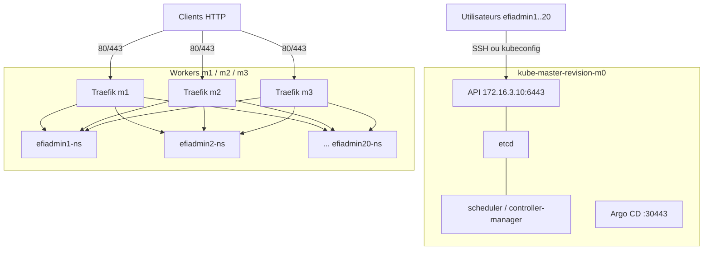

# Tutoriel — Plateforme Kubernetes v1.33 « Revision » multi-utilisateurs (Proxmox `infra-efi`)

> Document de référence du cluster Kubernetes installé le 10/10/2026 sur les VM 450 à 453 (node4).
> Les sections marquées ✅ décrivent ce qui a **réellement été exécuté** ; les sections 📘 sont des procédures d'utilisation et d'exploitation.

---

## 1. Vue d'ensemble

| Élément | Valeur |
|---|---|
| Distribution | Kubernetes **v1.33.13** installé avec kubeadm |
| Runtime | containerd **2.4.1** (dépôt officiel Docker), cgroup systemd |
| Réseau des pods (CNI) | **Canal** (Flannel VXLAN + Calico pour les NetworkPolicy), pods `10.244.0.0/16` |
| Services | `10.96.0.0/12` |
| API | `https://172.16.3.10:6443` |
| Ingress | **Traefik** (DaemonSet sur les workers, ports 80/443 des nœuds) |
| Stockage persistant | **local-path-provisioner** v0.0.37 (StorageClass `local-path` par défaut) |
| Métriques | **metrics-server** (`kubectl top`) |
| GitOps | **Argo CD** (interface `https://172.16.3.10:30443`) |
| Gestionnaire de paquets | **Helm v4.3.0** |
| Utilisateurs | **efiadmin1 → efiadmin20**, **administrateurs du cluster** (voient tout, gèrent le cluster) mais **ne peuvent ni modifier ni supprimer le travail des collègues** |

### 1.1 Nœuds

| Nœud Kubernetes | VM Proxmox | IP | Rôle | Ressources |
|---|---|---|---|---|
| kube-master-revision-m0 | 450 | 172.16.3.10 | control-plane (etcd, API, scheduler) | 2 vCPU, 6 Go, 30 Go |
| kube-worker-revision-m1 | 451 | 172.16.3.11 | worker | 2 vCPU, 6 Go, 30 Go |
| kube-worker-revision-m2 | 452 | 172.16.3.12 | worker | 2 vCPU, 6 Go, 30 Go |
| kube-worker-revision-m3 | 453 | 172.16.3.13 | worker | 2 vCPU, 6 Go, 30 Go |

OS : Debian 12 (bookworm), noyau 6.1. Réseau Proxmox : vnet SDN `newvnet` (172.16.0.0/16, passerelle 172.16.1.52). Disques : `local-lvm` de node4.

### 1.2 Schéma



---

## 2. Installation réalisée ✅

### 2.1 Préparation des VM

1. **Réseau** : les VM référençaient le bridge `vmbr1`, inexistant sur node4. `net0` a été rattaché à `newvnet` (adresses MAC conservées, configurations sauvegardées dans `/root/k8s-deploy/backup/`) :

```bash
qm set 450 --net0 virtio=BC:24:11:C1:49:B9,bridge=newvnet   # idem 451, 452, 453
qm start 450
```

2. **Accès SSH** : les images cloud n'acceptaient que les clés et l'agent QEMU n'est pas installé. La clé root d'Infra a été ajoutée aux clés cloud-init (clés existantes conservées), puis les VM ont été redémarrées.
3. **Contrôles** : Debian 12, `sudo` sans mot de passe pour `efi`, accès à `pkgs.k8s.io`, IP 172.16.3.10–13 libres.

### 2.2 Préparation commune des 4 nœuds (`scripts/k8s-common.sh`)

```bash
swapoff -a && sed -ri '/\sswap\s/ s/^([^#])/#\1/' /etc/fstab
printf 'overlay\nbr_netfilter\n' > /etc/modules-load.d/k8s.conf && modprobe overlay && modprobe br_netfilter
cat > /etc/sysctl.d/99-k8s.conf <<EOF
net.bridge.bridge-nf-call-iptables = 1
net.bridge.bridge-nf-call-ip6tables = 1
net.ipv4.ip_forward = 1
EOF
sysctl --system
# containerd (dépôt Docker) avec cgroup systemd
apt-get install -y containerd.io
containerd config default > /etc/containerd/config.toml
sed -i 's/SystemdCgroup = false/SystemdCgroup = true/' /etc/containerd/config.toml
systemctl restart containerd
# Kubernetes v1.33 (dépôt officiel), versions figées
curl -fsSL https://pkgs.k8s.io/core:/stable:/v1.33/deb/Release.key | gpg --dearmor -o /etc/apt/keyrings/kubernetes-apt-keyring.gpg
echo 'deb [signed-by=/etc/apt/keyrings/kubernetes-apt-keyring.gpg] https://pkgs.k8s.io/core:/stable:/v1.33/deb/ /' > /etc/apt/sources.list.d/kubernetes.list
apt-get update && apt-get install -y kubelet kubeadm kubectl && apt-mark hold kubelet kubeadm kubectl
```

### 2.3 Initialisation du control-plane

```bash
kubeadm init --apiserver-advertise-address=172.16.3.10 \
  --pod-network-cidr=10.244.0.0/16 --service-cidr=10.96.0.0/12 \
  --node-name kube-master-revision-m0
```

> [!WARNING]
> Les hostnames cloud-init contiennent des **majuscules** (`kube-master-Revision-M0`), interdites dans les noms de nœud Kubernetes. Premier essai en échec (`nodes "kube-master-Revision-M0" not found`) → `kubeadm reset -f` puis `--node-name` en minuscules. **Toujours passer `--node-name <nom-en-minuscules>`** pour `init` et `join`.

### 2.4 Jonction des workers

```bash
# sur le master
kubeadm token create --print-join-command
# sur chaque worker
kubeadm join 172.16.3.10:6443 --token <jeton> --discovery-token-ca-cert-hash sha256:<hash> \
  --node-name kube-worker-revision-m1
kubectl label node kube-worker-revision-m1 node-role.kubernetes.io/worker=
```

### 2.5 Add-ons (`scripts/k8s-addons.sh`)

```bash
# Helm (archive officielle + vérification sha256)
helm repo add traefik https://traefik.github.io/charts
helm repo add metrics-server https://kubernetes-sigs.github.io/metrics-server/
helm repo add argo https://argoproj.github.io/argo-helm

# Stockage persistant
kubectl apply -f https://raw.githubusercontent.com/rancher/local-path-provisioner/v0.0.37/deploy/local-path-storage.yaml
kubectl patch storageclass local-path -p '{"metadata":{"annotations":{"storageclass.kubernetes.io/is-default-class":"true"}}}'

# metrics-server
helm upgrade --install metrics-server metrics-server/metrics-server -n kube-system --set 'args={--kubelet-insecure-tls}'

# Traefik : DaemonSet, ports 80/443 des workers, IngressClass par défaut
helm upgrade --install traefik traefik/traefik -n traefik --create-namespace \
  --set deployment.kind=DaemonSet --set ports.web.hostPort=80 --set ports.websecure.hostPort=443 \
  --set service.type=ClusterIP --set ingressClass.isDefaultClass=true

# Argo CD : NodePort 30880 (HTTP) / 30443 (HTTPS)
helm upgrade --install argocd argo/argo-cd -n argocd --create-namespace \
  --set server.service.type=NodePort --set server.service.nodePortHttp=30880 --set server.service.nodePortHttps=30443
```

> [!NOTE]
> **Traefik plutôt qu'ingress-nginx** : le projet Kubernetes ingress-nginx est arrêté (fin de maintenance en mars 2026). Traefik gère les ressources `Ingress` standard.

Autocomplétion bash installée sur le master pour `kubectl` (et l'alias `k`), `helm`, `argocd`.

### 2.6 Passage de Flannel à Canal

Flannel n'applique pas les NetworkPolicy. Pour isoler réellement les utilisateurs au niveau réseau, le CNI a été remplacé par **Canal** (même réseau Flannel `10.244.0.0/16` + Calico pour les règles) : `bin/canal_migrate.sh`.

```bash
kubectl delete -f kube-flannel.yml
rm -f /etc/cni/net.d/10-flannel.conflist          # sur chaque nœud
kubectl apply -f https://raw.githubusercontent.com/projectcalico/calico/v3.33.0/manifests/canal.yaml
kubectl -n kube-system rollout status ds/canal
kubectl rollout restart deploy,ds,sts -n <namespace>   # rattache les pods existants à Canal
```

Incidents rencontrés pendant la migration et corrections :

| Incident | Cause | Correction |
|---|---|---|
| Pods `canal` en `Init:CrashLoopBackOff` : `This program can only be run on AMD64 processors with v2 microarchitecture support` | VM sans type de CPU défini → modèle Proxmox par défaut `kvm64` (pas de SSE4.2 / AVX) ; Calico v3.33 exige x86-64-v2 | CPU des VM 450–453 passé en **`x86-64-v3`** (`qm set <id> --cpu x86-64-v3` + redémarrage complet), AVX2 vérifié dans les 4 VM |
| Un pod Traefik reste `Pending` au redémarrage | DaemonSet avec ports 80/443 réservés sur le nœud + mise à jour qui crée le nouveau pod avant d'arrêter l'ancien (conflit de port) | `helm upgrade traefik ... --set updateStrategy.rollingUpdate.maxSurge=0 --set updateStrategy.rollingUpdate.maxUnavailable=1` |

> [!TIP]
> `x86-64-v3` est supporté par les 4 nœuds Proxmox (Xeon E-2488 et Xeon Silver 4310) : les VM restent migrables entre tous les nœuds, et les images exigeant x86-64-v2/v3 (Calico, MongoDB 5+, images RHEL 9…) fonctionnent.

Tests réels après migration (`bin/canal_tests.sh`, 11:33) :

| Test | Attendu | Résultat |
|---|---|---|
| Pod efiadmin1 → service efiadmin1 (même namespace) | OK | ✅ OK |
| Pod efiadmin2 → service efiadmin1 (autre namespace) | bloqué | ✅ **BLOQUÉ** |
| DNS depuis un namespace utilisateur | OK | ✅ OK |
| Accès via Ingress Traefik (`Host: np.test` sur 172.16.3.11) | 200 | ✅ 200 |
| Nœuds | 4 Ready | ✅ 4 Ready, aucun pod en erreur |


---

## 3. Modèle multi-utilisateurs ✅ (« admin du cluster protégé »)

### 3.1 Principe

Les candidats travaillent **en tant qu'administrateurs du cluster**. Chaque utilisateur `efiadminN` :

- **voit tout le cluster** : `kubectl get ns`, `get nodes`, `get all -A`, `kube-system`, `argocd`, logs, événements, configmaps… sans erreur `Forbidden` ;
- **crée ce qu'il veut** : namespaces, ClusterRoles, CRD, StorageClasses, Ingress, labels sur les nœuds… ;
- **ne peut pas toucher au travail d'un collègue** : tout objet situé dans un namespace marqué `tenant=<autre>` ou portant le label `tenant=<autre>` est en **lecture seule** pour lui ;
- **ne peut pas casser la plateforme** : les namespaces et objets système sont marqués `tenant=platform` (lecture seule) ;
- **ne lit pas les secrets des autres** (ni ceux de `kube-system` / `argocd`) : il lit uniquement les secrets de ses propres namespaces ;
- reste limité par Pod Security `baseline` (pas de pod privilégié), son quota et la NetworkPolicy dans `efiadminN-ns`.

Quatre mécanismes, mis en place par `scripts/k8s-tenant-clusteradmin.sh` puis `scripts/k8s-tenant-fix2.sh` :

| Mécanisme | Nom | Rôle |
|---|---|---|
| ClusterRole + ClusterRoleBinding | `efi-tenant-admin` / `efi-tenants-cluster` (utilisateurs efiadmin1..20) | tous les droits sur toutes les API **sauf** : lecture des secrets hors de ses namespaces, `bind`/`escalate`/`impersonate`, approbation de CSR ; lecture seule sur admissionregistration, Calico, flowcontrol, scheduling |
| ValidatingAdmissionPolicy | `efi-tenant-protection` (`scripts/efi-tenant-protection.yaml`) | refuse toute écriture sur ce qui appartient à un autre (`tenant=` ≠ soi), sur la plateforme, sur les nœuds (hors labels/annotations), les PV hostPath/local, les namespaces `privileged`, la suppression des `efiadminN-ns` |
| Pod Security par défaut | `/etc/kubernetes/psa/admission.yaml` (kube-apiserver) | `baseline` imposé à **tous** les namespaces, y compris ceux créés par les utilisateurs (exemptés : kube-system, traefik, local-path-storage) |
| Timer systemd | `efi-tenant-rbac-sync.timer` (toutes les 2 min) | ajoute au rôle les nouvelles API (CRD) et crée un RoleBinding `tenant-owner` (droits complets, secrets compris) dans chaque namespace marqué `tenant=efiadminN` |

> [!IMPORTANT]
> **Règle d'or pour les candidats** : tout namespace que vous créez doit être marqué à votre nom pour être protégé :
> `kubectl label ns <mon-namespace> tenant=efiadminN`. Un namespace **sans** label `tenant` est **partagé** : tout le monde peut y écrire (c'est le cas de `default`).

### 3.2 Objets créés pour chaque utilisateur (`scripts/k8s-tenants.sh`)

| Objet | Nom | Rôle |
|---|---|---|
| Namespace | `efiadminN-ns` | labels `tenant=efiadminN`, `pod-security.kubernetes.io/enforce=baseline`, `warn=restricted` ; ni supprimable ni déprotégeable |
| RoleBinding | `efiadminN-admin` | utilisateur `efiadminN` → ClusterRole `admin` (secrets compris) dans son namespace |
| ResourceQuota | `tenant-quota` | voir 3.3 (marqué `tenant=platform` : l'utilisateur ne peut pas le retirer) |
| LimitRange | `tenant-defaults` | ressources par défaut des conteneurs (protégé) |
| NetworkPolicy | `isolate-namespace` | entrées autorisées : même namespace + Traefik (protégée) |
| Certificat client | CN=`efiadminN`, O=`efi-tenants` | signé par la CA du cluster, valable **1 an** |
| Kubeconfig | `efiadminN.kubeconfig` | contexte `efiadminN@revision`, namespace par défaut `efiadminN-ns` |
| Compte Linux (master) | `efiadminN` | SSH, sans sudo, home 700, `~/.kube/config` déjà en place |

### 3.3 Quotas par namespace

| Ressource | Limite |
|---|---|
| CPU demandés / limites | 1 / 2 |
| Mémoire demandée / limites | 1 Gi / 2 Gi |
| Pods | 15 |
| PVC / stockage demandé | 5 / 10 Gi |
| Services NodePort / LoadBalancer | 0 / 0 (exposition via Ingress) |
| Défaut par conteneur (LimitRange) | limite 500m CPU / 512 Mi, demande 50m / 64 Mi |

> [!IMPORTANT]
> Capacité totale des 3 workers : 6 vCPU / 18 Go. Les quotas cumulés des 20 utilisateurs (20 CPU / 20 Gi demandés au maximum) dépassent la capacité : c'est volontaire (tout le monde n'utilise pas tout en même temps), mais si beaucoup d'utilisateurs déploient en même temps, des pods resteront `Pending`. Ajouter des workers dans ce cas (section 9.3).

### 3.4 Tests réels (10/10 à 11:49 et 11:51)

2 passages (30 + 28 tests). Les 2 échecs du 1er passage (label de nœud refusé à tort) ont été corrigés et validés au 2nd. Au 2nd passage, 2 tests sont marqués KO par erreur du script : le cordon a bien été refusé (code retour 0 malgré l’erreur) et il n’y avait aucun pod à supprimer.

| Test (en tant qu'efiadmin1 / efiadmin2) | Attendu | Résultat |
|---|---|---|
| `get ns`, `get nodes`, `get all -A`, `get all -n kube-system`, `get all -n argocd`, logs kube-system | OK | ✅ OK |
| efiadmin1 crée un deployment, un secret, un ClusterRole, un namespace `lab-efiadmin1` | OK | ✅ OK |
| efiadmin1 pose / retire un label sur un nœud | OK | ✅ OK |
| efiadmin2 supprime / scale le deployment d'efiadmin1, crée un objet dans `efiadmin1-ns` | refus | ✅ refusé (`efi-tenant-protection`) |
| efiadmin2 supprime `efiadmin1-ns` ou `lab-efiadmin1`, retire le label `tenant` | refus | ✅ refusé |
| efiadmin1 lit les secrets de kube-system, argocd, efiadmin2-ns | refus | ✅ `Forbidden` |
| efiadmin1 supprime coredns, fait `exec` dans kube-system, supprime son quota | refus | ✅ refusé |
| efiadmin1 supprime la politique, se donne cluster-admin, `--as=efiadmin2` | refus | ✅ refusé |
| efiadmin1 supprime / taint / cordon un nœud, `nodes/proxy` | refus | ✅ refusé |
| efiadmin1 crée un PV hostPath `/`, un pod privilégié, un namespace `privileged` | refus | ✅ refusé |
| efiadmin1 supprime son propre `efiadmin1-ns` | refus | ✅ refusé |
| Plateforme après changement | 4 Ready, pods Running | ✅ |

---

## 4. Guide utilisateur (efiadminN) 📘

### 4.1 Se connecter

**Option A — SSH sur le master (le plus simple)** :

```bash
ssh efiadmin3@172.16.3.10
# 1re connexion : mot de passe = nom du compte (efiadmin3), puis choix OBLIGATOIRE d’un nouveau mot de passe
kubectl get pods            # travaille directement dans efiadmin3-ns
k get all                   # alias k = kubectl, autocomplétion avec Tab
```

**Option B — depuis votre poste** (si le réseau 172.16.0.0/16 est joignable) :

```bash
mkdir -p ~/.kube && cp efiadmin3.kubeconfig ~/.kube/config && chmod 600 ~/.kube/config
kubectl get pods
```

### 4.2 Commandes de base

```bash
kubectl config view --minify | grep namespace   # votre namespace
kubectl get all                                  # tout ce qui tourne chez vous
kubectl describe pod <pod>                       # détail / événements
kubectl logs -f deploy/<nom>                     # journaux
kubectl exec -it deploy/<nom> -- sh              # shell dans un conteneur
kubectl top pods                                 # consommation CPU / mémoire
kubectl describe quota tenant-quota              # votre quota utilisé / restant
kubectl get events --sort-by=.lastTimestamp      # événements récents
```

### 4.3 Déployer une application et l'exposer (exemple complet)

```bash
kubectl create deployment web --image=nginx:stable --replicas=2
kubectl expose deployment web --port=80
kubectl create ingress web --rule="web-efiadmin3.revision.local/*=web:80"
kubectl get pods,svc,ingress
```

Test depuis le master ou un poste du réseau :

```bash
curl -H 'Host: web-efiadmin3.revision.local' http://172.16.3.11/
```

> [!TIP]
> Pour un accès par nom, ajouter `172.16.3.11 web-efiadmin3.revision.local` dans le fichier `hosts` du poste client, ou créer un enregistrement DNS pointant vers l'un des workers. **Convention : préfixer ou suffixer chaque nom d'hôte par votre identifiant** (ex. `web-efiadmin3...`) pour ne pas entrer en conflit avec les autres utilisateurs.

### 4.4 Manifeste YAML recommandé (ressources, sécurité)

```yaml
apiVersion: apps/v1
kind: Deployment
metadata:
  name: api
spec:
  replicas: 2
  selector: {matchLabels: {app: api}}
  template:
    metadata: {labels: {app: api}}
    spec:
      securityContext:
        runAsNonRoot: true
        seccompProfile: {type: RuntimeDefault}
      containers:
      - name: api
        image: nginxinc/nginx-unprivileged:stable
        ports: [{containerPort: 8080}]
        resources:
          requests: {cpu: 100m, memory: 128Mi}
          limits: {cpu: 500m, memory: 256Mi}
        securityContext:
          allowPrivilegeEscalation: false
          capabilities: {drop: [ALL]}
```

```bash
kubectl apply -f api.yaml
```

### 4.5 Stockage persistant (PVC)

```yaml
apiVersion: v1
kind: PersistentVolumeClaim
metadata: {name: data}
spec:
  accessModes: [ReadWriteOnce]
  resources: {requests: {storage: 2Gi}}
```

```bash
kubectl apply -f pvc.yaml
kubectl get pvc          # "Pending" jusqu'au premier pod qui l'utilise (normal), puis "Bound"
```

> [!WARNING]
> `local-path` stocke les données **sur le disque du worker** où le pod a démarré : le pod restera lié à ce worker et les données ne sont **pas répliquées**. Ne pas y mettre de données critiques sans sauvegarde.

### 4.6 Helm dans son namespace

```bash
helm repo add bitnami https://charts.bitnami.com/bitnami
helm install mon-redis bitnami/redis --set architecture=standalone \
  --set master.resources.requests.memory=128Mi --set master.resources.limits.memory=256Mi
helm list
helm uninstall mon-redis
```

Les charts qui créent des objets *cluster* (CRD, ClusterRole…) fonctionnent. Installez-les de préférence dans un namespace marqué à votre nom.

### 4.7 Donner un accès à un collègue dans son namespace

```bash
kubectl create rolebinding lecture-collegue --clusterrole=view --user=efiadmin5
```

Vous ne pouvez accorder que des droits que vous possédez. Pour **travailler à plusieurs**, utiliser un namespace **sans** label `tenant` (partagé).

### 4.8 Ce qui est autorisé / interdit (et pourquoi)

| Action | Résultat | Raison |
|---|---|---|
| Lire tout le cluster (ns, nodes, kube-system, argocd, logs) | ✅ autorisé | vous êtes admin |
| Créer namespaces, CRD, ClusterRoles, Ingress, labels de nœud | ✅ autorisé | vous êtes admin |
| Modifier / supprimer un objet d'un namespace `tenant=<collègue>` | refusé (`efi-protection`) | protection du travail des autres |
| Modifier la plateforme (kube-system, traefik, argocd, objets `tenant=platform`) | refusé | stabilité du cluster |
| Lire les secrets hors de vos namespaces | Forbidden | confidentialité (Argo CD, jetons système) |
| Supprimer / taint / cordon / drain un nœud | refusé | expulserait les pods des collègues |
| Pod `privileged`, `hostPath`, `hostNetwork`, PV hostPath | refusé | évasion vers le nœud |
| Supprimer ou déprotéger votre `efiadminN-ns` | refusé | namespace personnel permanent |
| Service `NodePort` / `LoadBalancer` dans `efiadminN-ns` | refusé par le quota | exposer via Ingress |
| Joindre un pod de `efiadminN-ns` depuis un autre namespace | bloqué (timeout) | NetworkPolicy |

Les avertissements `would violate PodSecurity "restricted"` sont informatifs : le pod est créé, mais il est conseillé d'appliquer les bonnes pratiques de la section 4.4.

---

## 5. Guide administrateur 📘

Toutes les commandes s'exécutent sur le master avec les droits root (`ssh efi@172.16.3.10` puis `sudo -i`).

### 5.1 État du cluster

```bash
kubectl get nodes -o wide
kubectl get pods -A
kubectl top nodes
kubectl get --raw='/readyz?verbose' | tail -3
for n in $(seq 1 20); do kubectl -n efiadmin$n-ns describe quota tenant-quota | grep -E 'pods|requests.memory' | tr -s ' ' | paste -sd' ' | sed "s/^/efiadmin$n: /"; done
```

### 5.2 Ajouter un utilisateur (ex. efiadmin21)

Relancer le script en adaptant la boucle (`seq 21 21`) dans `scripts/k8s-tenants.sh` et `scripts/k8s-sshusers.sh`, ou manuellement :

```bash
U=efiadmin21; NS=$U-ns
kubectl create namespace $NS
kubectl label namespace $NS tenant=$U pod-security.kubernetes.io/enforce=baseline pod-security.kubernetes.io/warn=restricted
kubectl -n $NS create rolebinding $U-admin --clusterrole=admin --user=$U
# + ResourceQuota / LimitRange / NetworkPolicy (copier depuis efiadmin1-ns) :
kubectl -n efiadmin1-ns get resourcequota tenant-quota -o yaml | sed "s/efiadmin1-ns/$NS/" | grep -vE 'uid:|resourceVersion:|creationTimestamp:' | kubectl apply -f -
# Certificat : openssl genrsa / req (CN=$U) -> CertificateSigningRequest -> kubectl certificate approve $U
```

### 5.3 Retirer ou suspendre un utilisateur

```bash
# Suspendre les droits cluster : retirer l'utilisateur du ClusterRoleBinding
kubectl edit clusterrolebinding efi-tenants-cluster                # supprimer la ligne efiadmin5
kubectl -n efiadmin5-ns delete rolebinding efiadmin5-admin tenant-owner --ignore-not-found
usermod -L -e 1 efiadmin5                                          # verrouille le compte SSH
kubectl label ns efiadmin5-ns tenant- && kubectl delete namespace efiadmin5-ns   # suppression définitive
```

> [!IMPORTANT]
> Un certificat client **ne peut pas être révoqué** dans Kubernetes. Retirer l'utilisateur du ClusterRoleBinding et des RoleBindings suffit à retirer ses droits. Ne jamais réutiliser le même nom pour une autre personne avant l'expiration du certificat.

### 5.3 bis Gérer la protection

```bash
kubectl get validatingadmissionpolicy,validatingadmissionpolicybinding efi-tenant-protection
kubectl get ns -L tenant                                            # propriétaire de chaque namespace
kubectl label ns <ns> tenant=efiadminN --overwrite                  # attribuer un namespace
kubectl delete validatingadmissionpolicybinding efi-tenant-protection   # DÉSACTIVER la protection (urgence)
kubectl apply -f /root/efi-tenant-protection.yaml                   # la réactiver (copie Infra : scripts/efi-tenant-protection.yaml)
systemctl status efi-tenant-rbac-sync.timer                         # resynchronisation du rôle
```

Retour complet à l'ancien modèle (admin de son namespace uniquement) : `kubectl delete clusterrolebinding efi-tenants-cluster`.

### 5.4 Renouveler un certificat utilisateur (avant 1 an)

Supprimer `/root/k8s-users/efiadminN.kubeconfig` et relancer `scripts/k8s-tenants.sh` (il ne régénère que les kubeconfig manquants), puis recopier dans `/home/efiadminN/.kube/config` :

```bash
install -m 600 -o efiadmin3 -g efiadmin3 /root/k8s-users/efiadmin3.kubeconfig /home/efiadmin3/.kube/config
```

### 5.5 Modifier le quota d'un utilisateur

```bash
kubectl -n efiadmin3-ns patch resourcequota tenant-quota --type merge \
  -p '{"spec":{"hard":{"requests.memory":"2Gi","limits.memory":"4Gi"}}}'
```

### 5.6 Réinitialiser le mot de passe SSH d'un utilisateur

```bash
passwd efiadmin3 && chage -d 0 efiadmin3
```

Mots de passe initiaux : identiques au nom du compte (`efiadminN` / `efiadminN`), changement imposé à la 1re connexion. Liste : `/root/k8s-users/ssh-passwords.txt` (master) et `/root/k8s-deploy/users/ssh-passwords.txt` (Infra).

### 5.7 Argo CD

```bash
# Mot de passe admin (root uniquement ; le secret argocd-initial-admin-secret a été supprimé)
cat /root/argocd-admin-password.txt
argocd login 172.16.3.10:30443 --username admin --insecure
argocd account update-password
```

Interface : `https://172.16.3.10:30443` (n'importe quelle IP de nœud). Argo CD possède des droits cluster-admin : **ne pas donner le compte admin aux candidats** (il contournerait la protection). Pour leur donner Argo CD : un **AppProject** par utilisateur limité à ses namespaces + comptes locaux Argo CD (évolution recommandée).

### 5.8 Sauvegarde etcd (master unique : indispensable)

```bash
ETCDCTL_API=3 kubectl -n kube-system exec etcd-kube-master-revision-m0 -- etcdctl \
  --endpoints=https://127.0.0.1:2379 --cacert=/etc/kubernetes/pki/etcd/ca.crt \
  --cert=/etc/kubernetes/pki/etcd/server.crt --key=/etc/kubernetes/pki/etcd/server.key \
  snapshot save /var/lib/etcd/snapshot-$(date +%F).db
cp /var/lib/etcd/snapshot-*.db /root/ && tar czf /root/pki-$(date +%F).tgz /etc/kubernetes/pki
```

Copier régulièrement ces fichiers hors de la VM (Infra, PBS). Sauvegarder aussi les VM 450–453 avec vzdump.

### 5.9 Certificats du cluster (1 an)

```bash
kubeadm certs check-expiration
kubeadm certs renew all && systemctl restart kubelet   # avant expiration (≈ 10/10/2027)
```

### 5.10 Mise à jour mineure (ex. 1.33.x)

```bash
apt-mark unhold kubeadm && apt-get install -y kubeadm=1.33.* && apt-mark hold kubeadm
kubeadm upgrade plan && kubeadm upgrade apply v1.33.<x>
# puis kubelet/kubectl, nœud par nœud : kubectl drain <nœud> --ignore-daemonsets --delete-emptydir-data ; upgrade ; kubectl uncordon <nœud>
```

---

## 6. Réseau et sécurité 📘

| Sujet | État | Recommandation |
|---|---|---|
| SSH `efi` | mot de passe `efi` activé (demande utilisateur) via `/etc/ssh/sshd_config.d/01-password-auth.conf` | **changer le mot de passe** ; idéalement repasser en clés uniquement |
| SSH `efiadminN` | mot de passe initial = nom du compte, changement obligatoire à la 1re connexion (10/10 11:58), pas de sudo | tant qu’un candidat ne s’est pas connecté, son compte reste accessible avec le mot de passe initial ; fail2ban |
| Clé root d'Infra | présente dans les VM (cloud-init) | retirable dans Proxmox → Cloud-Init → SSH keys |
| IP fixes 172.16.3.10–13 | dans la plage DHCP de `newvnet` | réserver ces IP / réduire la plage |
| metrics-server | `--kubelet-insecure-tls` | durcir (certificats serving kubelet signés) |
| Ingress | un utilisateur peut déclarer un nom d'hôte déjà utilisé par un autre | convention de nommage par utilisateur |
| Kubeconfigs | contiennent les clés privées | transmettre par canal sûr |

---

## 7. Dépannage 📘

| Symptôme | Cause probable | Action |
|---|---|---|
| Pod `Pending` | quota atteint ou workers pleins | `kubectl describe pod` (événements), `kubectl describe quota`, `kubectl top nodes` |
| `exceeded quota` | pas de `resources` et quota | le LimitRange met des valeurs par défaut ; réduire les demandes |
| `violates PodSecurity "baseline"` | pod privilégié / hostPath | retirer ces options |
| PVC `Pending` | normal avant le premier pod (WaitForFirstConsumer) | démarrer le pod qui l'utilise |
| Ingress 404 | mauvais `Host` ou service | `kubectl describe ingress`, tester avec `curl -H 'Host: ...'` |
| `Forbidden` sur `secrets` | secrets hors de vos namespaces | normal ; marquer son namespace `tenant=efiadminN` (droits complets sous 2 min) |
| `ValidatingAdmissionPolicy 'efi-tenant-protection' ... denied` | objet appartenant à un collègue ou à la plateforme | normal ; le message indique le propriétaire |
| Nœud `NotReady` | kubelet / containerd / Canal | `systemctl status kubelet containerd`, `kubectl -n kube-system get pods -o wide \| grep canal` |
| `x509: certificate has expired` | certificat utilisateur > 1 an | section 5.4 |

---

## 8. Points d'attention de l'architecture

1. **Point unique de panne** : les 4 VM sont sur **node4** et sur `local-lvm`. Si node4 tombe, tout le cluster tombe.
2. **Master unique** : pas de haute disponibilité du control-plane ; sauvegarder etcd (5.8).
3. **Stockage local** : `local-path` n'est pas répliqué.
4. **Capacité** : 3 workers de 6 Go pour 20 utilisateurs.

## 9. Évolutions recommandées

1. Après validation de Ceph (switch prévu lundi) : déplacer les disques des VM sur `ceph-vm` et répartir les workers sur plusieurs nœuds Proxmox (migration à froid entre node4 et les autres nœuds, CPU différents).
2. **Ceph RBD CSI** comme StorageClass répliquée (remplace `local-path` pour les données importantes).
3. Ajouter des workers : nouvelle VM préparée avec `k8s-common.sh`, puis `kubeadm join ... --node-name <minuscules>`.
4. Control-plane HA (3 masters) + IP virtuelle.
5. Argo CD multi-utilisateurs (AppProject par utilisateur).
6. cert-manager + certificats TLS pour Traefik.

## 10. Fichiers de référence

| Chemin (Infra) | Contenu |
|---|---|
| `/root/k8s-deploy/scripts/k8s-common.sh` | préparation des nœuds |
| `/root/k8s-deploy/scripts/k8s-master.sh` | kubeadm init + CNI |
| `/root/k8s-deploy/scripts/k8s-addons.sh` | Helm, local-path, metrics-server, Traefik, Argo CD |
| `/root/k8s-deploy/scripts/k8s-tenants.sh` | 20 utilisateurs, namespaces, RBAC, quotas, certificats |
| `/root/k8s-deploy/scripts/k8s-sshusers.sh` | comptes SSH des utilisateurs |
| `/root/k8s-deploy/scripts/k8s-tenant-clusteradmin.sh` | modèle « admin du cluster protégé » (PSA par défaut, marquage plateforme, politique, rôle, tests) |
| `/root/k8s-deploy/scripts/k8s-tenant-fix2.sh` | correctifs (secrets, nœuds, PV hostPath, namespaces perso) + tests |
| `/root/k8s-deploy/scripts/efi-tenant-protection.yaml` | ValidatingAdmissionPolicy de protection |
| `/root/k8s-deploy/scripts/efi-tenant-rbac-sync.sh` | génération du ClusterRole `efi-tenant-admin` (master : `/usr/local/sbin/`) |
| `/root/k8s-deploy/scripts/k8s-completion.sh` | autocomplétion |
| `/root/k8s-deploy/bin/canal_migrate.sh` | migration Flannel → Canal + tests |
| `/root/k8s-deploy/users/` | kubeconfigs + mots de passe initiaux (root uniquement) |
| `/root/k8s-deploy/logs/` | journaux d'exécution |
| `/root/k8s-deploy/RESUME_K8S.md` | résumé |
